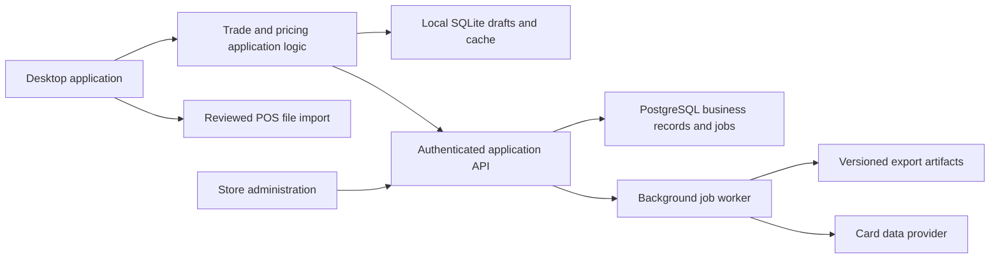

# OCC Card Pricer Commercial Product Expansion Plan

Build a configurable trade intake and pricing product for independent card stores. Keep the working Java desktop client, extract reusable business logic, and introduce a central service for accounts and shared transactions. Preserve local catalog lookup and recoverable drafts so store staff can continue preparing trades during an outage.

The first product should do one workflow reliably: identify the exact printing, price a trade under the store's rules, save it durably, and produce a verified POS import. Broader inventory management and additional games should follow successful store pilots.

Planning baseline: October 8, 2026; version 5.0.8 plus the current local lookup and CSV fixes. The source contains 93 Java files and approximately 17,200 lines. The latest local Maven verification passed 223 unit/workflow tests and one packaging integration test. Those results establish a regression baseline, not a capacity measurement or proof of POS acceptance.

Implementation update: the desktop performance and recovery work now includes incremental trade totals, background draft encoding, bounded/coalesced saves, multiple recoverable drafts with edit-parent revisions, and SQL history pagination. [Implementation and synthetic measurements](DESKTOP_SCALABILITY.md) record what changed and the remaining capacity checks. The findings below retain the original planning baseline.

## Initial product scope

Use these proposed boundaries for the first commercial beta; validate them with prospective stores before committing to a launch date.

| Area | Initial scope |
|---|---|
| Customers | Three to five independent pilot businesses; up to five active workstations per business |
| Workflow | MTG price checks, trade intake, payment allocation, saved revisions, and receiving exports |
| Platforms | Packaged Windows and macOS desktop applications with a bundled runtime |
| Money | USD initially, with an explicit currency on every quote and trade |
| POS support | The current POS format after acceptance testing, plus one additional profile chosen from pilot demand |
| Offline behavior | Cached prices and durable drafts; hosted trade finalization requires connectivity in the initial hosted product |
| Inventory authority | The store's POS owns stock counts initially; this product records receiving/export/import status |
| Customization | Store settings and versioned profiles, using one common release for all stores |

Requiring connectivity for hosted finalization is a proposed product tradeoff. It changes today's local approval capability and must be agreed before migration. If offline completed transactions are essential, budget a separate workflow with durable command IDs, provisional status, conflict handling, and payout reconciliation. Reconnecting must never require paying the customer twice.

## Existing foundations to preserve

- **Exact financial calculations.** Keep the settlement engine, cent reconciliation, saved valuations, and saved buy rates. A software or catalog update must not reprice an approved trade.
- **Recoverable transactions.** Keep the atomic snapshot/output-job commit, revision checks, retained earlier revisions, and idempotent export retry behavior in [TradeRepository](../src/com/cardpricer/service/TradeRepository.java).
- **Provider identity.** Keep printing IDs, collector markers, languages, immutable catalog records, and detached UI card copies. POS aliases belong at the export boundary.
- **Local operation.** Keep SQLite and cached catalog access on each workstation. SQLite remains appropriate for device storage and caching; its documentation distinguishes those uses from a database directly shared by many computers. [SQLite deployment guidance](https://sqlite.org/whentouse.html).
- **Existing verification.** Expand the crash recovery, competing edits, deletion, rate conflict, CSV, and packaging tests. Preserve the Windows/macOS build matrix.

## Findings that should drive the work

Priorities below describe product risk and likely scaling pressure. Performance findings are based on the work the code performs; measure their actual cost before setting supported limits.

| Priority | Current evidence | Consequence | Planned change |
|---|---|---|---|
| P0 | [TradeInventoryCode](../src/com/cardpricer/service/TradeInventoryCode.java), [CardEntry](../src/com/cardpricer/model/CardEntry.java), and [CsvExportService](../src/com/cardpricer/service/CsvExportService.java) independently construct stock codes. The latest surge fix covers trade receiving and trade quantity exports. | The same printing can receive different codes in trade and catalog/inventory workflows. | One versioned mapping policy per store/POS profile, shared by every applicable exporter. |
| P0 | [CardSearchDialog](../src/com/cardpricer/gui/dialog/CardSearchDialog.java) offers Normal/Foil/Etched; typed entry also supports Surge. [ProviderCardMapper](../src/com/cardpricer/service/ProviderCardMapper.java) does not retain `promo_types`. | F2, typed entry, and imports can disagree about treatment and finish. | One resolved-card selection model, preservation of treatment metadata, and the same available choices across entry paths. |
| P0 | [TradeDraft](../src/com/cardpricer/model/TradeDraft.java) has employee/customer strings but no organization, location, authenticated actor, or currency. Shared revisions use OS account/workstation labels. | There is no application-enforced boundary between independent businesses or permission model for staff actions. | Introduce organization ownership and identity before hosted sharing; enforce authorization at the service boundary. |
| P0 | [TradePosEncoder](../src/com/cardpricer/service/TradePosEncoder.java) fixes department `5`, category `5.2`, `TAX`, and comma replacement. [PricingService](../src/com/cardpricer/service/PricingService.java) fixes floors and rounding, including the $9.50 exception. | Another store inherits OCC-specific behavior. | Preserve these as the initial OCC profile; make alternative rules explicit configuration with previews and version history. |
| P1 | [TradePanel](../src/com/cardpricer/gui/panel/TradePanel.java) has 2,235 lines; summary refresh traverses every row and updates rate cells. `snapshotDraft()` rebuilds all lines on the Swing thread. | Editing large trades can stall the UI even when the eventual disk write runs in the background. | Extract a trade editor model, update changed rows incrementally, and move snapshot encoding off the UI thread. |
| P1 | [TradeSessionService](../src/com/cardpricer/service/TradeSessionService.java) queues whole snapshots on a single executor and uses one `draft-v1.json`. Edited-draft context is saved in that file. | Work can queue faster than storage completes; recovery and multiple drafts are tied to one global file. | A draft repository keyed by draft ID, saved edit-parent revision, bounded/coalesced autosaves, and visible durable-save status. |
| P1 | [SharedTradeService](../src/com/cardpricer/service/SharedTradeService.java) rewrites one JSON document containing all revisions and output contents. Publishing revisits historical outputs. [InventoryStatusSyncService](../src/com/cardpricer/service/InventoryStatusSyncService.java) rereads all status documents. | Routine sync work grows with historical activity. Shared saves also acquire the common deletion/files lock. | Replace shared-folder transaction coordination with a central API and incremental change feed. Preserve the old transport for compatibility during migration. |
| P1 | [TradeReceivingExportService](../src/com/cardpricer/service/TradeReceivingExportService.java) enumerates local outputs on sync; [SharedFolderSyncService](../src/com/cardpricer/service/SharedFolderSyncService.java) hashes each enqueued file. | Even unchanged histories repeatedly generate filesystem work. | Enqueue output delivery at commit time, track immutable artifact hashes, and retry bounded batches. |
| P1 | [HistoryIndex](../src/com/cardpricer/service/HistoryIndex.java) already provides FTS and changed-file indexing, but [TradeHistoryService](../src/com/cardpricer/service/TradeHistoryService.java) builds a full summary snapshot. [FileManagerPanel](../src/com/cardpricer/gui/panel/FileManagerPanel.java) applies the 100-row limit after iterating those records. | The UI has paging, but the underlying data retrieval is not paginated. | Indexed date/status/payment fields, database filtering, cursor pagination, and separate aggregate queries. |
| P1 | [TaskCoordinator](../src/com/cardpricer/service/TaskCoordinator.java) is bounded, while other screens use default SwingWorker execution and services own additional executors. API errors are sometimes recognized by message text. | Queue saturation, cancellation, and retry behavior vary by workflow. | A common task lifecycle, explicit overload feedback, typed provider errors, bounded retries, and separate capacity for saving versus optional refreshes. |
| P1 | [TradeDraft](../src/com/cardpricer/model/TradeDraft.java) includes identification in serialized snapshots. [build.ps1](../build.ps1) and [build.sh](../build.sh) package apps without an explicit signing/notarization stage. | Data handling and installation/support requirements are unfinished for external stores. | Minimize collected data, define retention and access, add tested backup/restore, and establish signed release procedures. |

The current inventory screen is a quantity export tool, not a stock transaction ledger. Preserve that distinction in product language. Treating an exported file or an operator checkbox as proof of an external POS import would overstate what the app knows.

## What should be removed or retired

Removal should follow replacement and compatibility checks. Existing customer records, revision history, and deletion markers are not cleanup targets.

| Item | Action |
|---|---|
| Tracked `lib/` JARs and the separate IntelliJ artifact recipe | Make Maven the only release build. Remove duplicate/manual dependencies after verifying a clean checkout builds and supported IDE instructions use Maven. JavaMail and activation are present in `lib/` but absent from the current Maven dependencies. |
| Machine-specific IDE configuration | Remove tracked references such as the OpenJFX ZIP under a user's Downloads directory. Keep only useful shared project settings. |
| Unused compatibility wrappers and demo code | Verify callers, then remove `TradePanel.saveList()`, `exportToPOS()`, the old receipt writer if unused, `ScryfallApiService`'s demo `main` and unused image helper, and obsolete update-version parsing. Keep readers needed to migrate old data. |
| Multiple pricing, finish, and SKU implementations | Replace them with shared domain policies and explicit POS profiles. Do not add more isolated exceptions in each screen. |
| Business services reading `PreferencesPanel` or creating Swing dialogs | Inject application configuration and return typed results. UI code owns dialogs; services must also run in a server or command-line migration tool. |
| Store identity mixed into product defaults | Separate product branding and support/release endpoints from each store's name, receipt details, rate policies, and POS settings. Another store should not need source edits. |
| Silent failures and string-matched errors | Use structured error categories, actionable row-level messages, and privacy-filtered logs. Optional update checks may remain nonblocking, but failures should be diagnosable. |
| Shared folders as the future transaction authority | Retain a compatibility adapter and file delivery where stores need it. Move coordination of hosted transactions and staff permissions to the service. |
| Stale documentation links | The README points to deleted `audit/` documents. Replace them with maintained architecture, migration, POS acceptance, and release documents. |
| Growing handwritten infrastructure | Evaluate replacing custom PDF generation and HTTP retry plumbing with maintained components when their requirements are clear. Preserve Unicode and receipt tests before replacing working behavior. |

## Target architecture

Use one desktop application and one modular backend application initially. Give modules clear ownership and interfaces before considering separate services.

PostgreSQL is a proposed central database, while SQLite remains device-local. The reason to add a server is coordinated ownership, authorization, and concurrent transactions. Simply placing the current SQLite file on a network share is unsuitable: SQLite WAL requires participating processes to be on the same host. [SQLite WAL constraints](https://sqlite.org/wal.html).

Suggested ownership boundaries:

- **Catalog:** provider IDs, printing metadata, treatment metadata, supported finishes, price observations, and freshness. Share provider data only where its usage terms permit; store-specific valuations remain private.
- **Trade domain:** lines, condition, quantities, overrides, immutable quotes, payment allocation, approval, and correction rules. Depend on interfaces, not Swing, JSON parsing, or filesystem paths.
- **Store configuration:** organization/location settings, buy rates, rounding, supported currency, receipt identity, and POS profile versions. Persist the relevant policy version with each approval.
- **Application commands:** prepare quote, save draft, approve trade, revise trade, generate/retry export, and record POS acknowledgment. Each command has a clear result and failure state.
- **Adapters:** Scryfall access, SQLite storage, backend transport, POS encoding, receipts, and existing shared-folder migration.
- **Operations:** authenticated staff, permissions, diagnostics, backups, migrations, entitlements, and release management.

Represent provider printing identity, physical treatment, selected finish, and POS stock code as distinct concepts. A provider collector such as `129★` must remain exact even when a store's export code is `40K 129S`. Unknown treatments should produce an explicit unsupported/review state rather than silently becoming an ordinary foil.

## Business ownership and access

An **organization** is the independent business; a **location** is one of its stores. Give every private trade, revision, draft, rate profile, export, job, and audit entry an organization owner. Use stable user and device IDs, with memberships and roles such as owner, manager, buyer, and read-only staff.

For hosted operation, derive organization access from verified identity and current membership. Client-supplied organization IDs select a context but cannot grant access. Apply ownership checks to background jobs, caches, files, and restore operations as well as API requests. [OWASP tenant isolation guidance](https://cheatsheetseries.owasp.org/cheatsheets/Multi_Tenant_Security_Cheat_Sheet.html).

Use PostgreSQL row security as an additional boundary, with transaction-scoped organization context and a runtime role that is neither table owner nor granted `BYPASSRLS`. Include organization IDs in relevant unique keys and relationships. Row security needs deliberate role design because privileged roles and normally table owners bypass it. [PostgreSQL row security](https://www.postgresql.org/docs/current/ddl-rowsecurity.html).

Desktop sign-in should use the system browser with authorization code and PKCE; keep tokens in the OS credential store and do not distribute a shared client secret. This follows the native-app OAuth model in [RFC 8252](https://www.rfc-editor.org/rfc/rfc8252).

Prefer making identification collection optional and absent from ordinary export/support bundles. If a store needs it, provide restricted access, documented retention, and an explicit deletion process. Record actor, reason, time, device, and before/after references for sensitive changes. Separate financial corrections, voids, privacy deletion, and account closure rather than treating them all as unrestricted file deletion.

Use TLS for service access, protect backup and artifact storage, and keep deployment credentials in managed secret storage. Define staff revocation and lost-device procedures, including what previously cached information remains on an offline workstation. Support access to store data should be explicitly granted, time-limited, and audited.

## Durable transactions and sync

Keep four statuses separate: **draft saved**, **trade approved**, **export delivered**, and **POS import acknowledged**. A failure at one stage must identify that stage and preserve completed work.

For hosted approvals and corrections:

1. Send a stable command ID, trade ID, and expected committed revision. Keep an edit sequence separate from the committed revision number; autosaving should not advance the business revision.
2. In one server transaction, validate ownership and permissions, verify the expected revision, store the approved snapshot/settlement, and record the command result and output jobs.
3. If a response is lost, retry the same command ID and retrieve its result. Reject reuse of that ID with different command contents.
4. Generate exports from the approved snapshot and pinned profile version. Persist artifact identity and hash. Retries must not reprice the trade or create another payment instruction.
5. Deliver changes through a bounded cursor-based feed, with durable client checkpoints and periodic reconciliation. Delayed jobs must retain organization ownership and recheck applicable authorization.

Use append-only revision records rather than rewriting a document containing every prior revision. Keep immutable output bytes where exact reproduction matters; archive them under a defined retention policy. Add job leases, attempt history, backoff, and a failed-job review queue before running multiple workers.

CSV import cannot guarantee that an external POS applied a file exactly once. Include an export/batch identifier where the supported format permits it, record the imported trade revision, and require an explicit reconciliation workflow for corrected trades. Validate vendor behavior for duplicate SKUs, quantity snapshots versus increments, zero quantities, conditions, tax/category fields, and repeated imports using real accepted fixtures.

## Product capabilities to add

| Timing | Capability | Completion criterion |
|---|---|---|
| Before independent pilots | First-run setup for store details, rates, POS profile, data directory, and backup destination | A store owner can configure a sample trade and inspect its CSV without developer file edits. |
| Before independent pilots | Mapping and price review | Failed lookup or ambiguous printing stays visible as an unresolved row. Conversion to MISC is an explicit choice. Show which input, lookup identity, finish, and output code are involved. |
| Before independent pilots | Multiple named drafts and recovery | A restart restores new and edited drafts with prices, quantities, original trade IDs, and parent revisions intact. |
| Before independent pilots | Backup, restore, and migration tools | A backup restores on a clean machine and preserves revisions, rates, edit context, output jobs, and deletion records. Use a SQLite-consistent backup operation, not a blind copy of an active database file. |
| Before independent pilots | Diagnostic bundle and support workflow | The owner can preview a redacted bundle containing versions, job errors, schema versions, queue sizes, and timings. Customer identity and authentication secrets are excluded by default. |
| Before hosted pilots | Organization accounts, staff permissions, device enrollment, and account recovery | Tests deny cross-business access and unauthorized approvals, edits, deletions, rate changes, and export downloads. |
| Before paid general availability | Signed distribution, release channels, compatibility notices, and migration recovery | Upgrade on clean Windows/macOS machines, including supported Mac architectures; test recovery of an edited draft during upgrade. |
| Before paid general availability | Subscription/entitlement administration and complete data export | Stores can leave with their data. Define a billing-outage grace policy so a transient entitlement check cannot strand recovery work. Use a billing provider rather than storing card payment credentials. |
| After stable pilots | Operational reporting | Report receiving value, payout mix, overrides, price freshness, and pending imports from approved records. Do not claim realized profit without sales/cost reconciliation. |
| After demonstrated demand | Additional POS integrations, games, currencies, and optional browser administration | Each addition uses a versioned adapter and passes the same identity, settlement, recovery, and export contract suite. |

## Implementation sequence

Each phase has a release gate. This is an ordered backlog, not a calendar commitment; effort depends especially on the selected POS, offline-finalization requirement, and available engineering/support capacity.

| Phase | Deliverables | Gate before moving on |
|---|---|---|
| 0 — Establish the product contract | Interview pilot stores; select supported POS versions and operating systems; agree offline behavior and pricing-data usage; capture accepted CSVs; benchmark the existing build. | Written supported workflow, fixtures, workload profiles, and unresolved commercial decisions. |
| 1 — Unify identity and store policies | Shared printing/finish/treatment resolution; one mapping service; OCC behavior as a versioned profile; export preview; consistent F2, typed, paste, catalog, and inventory behavior. | Exact examples `40K 129s`, `PEOE 219pf`, `PEOE 219sf`, and List/base pairs preserve identity and produce the selected profile's codes across workflows. |
| 2 — Strengthen the desktop core | Extract editor/application services; durable draft repository; incremental totals; paginated history; bounded background work; backup/restore; actionable diagnostics. | Existing financial/recovery tests pass and the proposed local performance/recovery gates below are measured. |
| 3 — Build the hosted ownership boundary | Modular Java API, PostgreSQL schema, organization membership, permissions, command deduplication, revision checks, output jobs, artifact access, and incremental sync. | Concurrent-edit, lost-response, tenant-isolation, revoked-user, and worker-retry tests pass. There is one authority for each migrated trade. |
| 4 — Migrate and pilot | Store onboarding, signed packages, documented support, staged account migration, real POS acceptance, entitlement administration, and incident/restore drills. | Three to five independent stores complete representative workflows without custom code branches; every severe incident has a recovery procedure. |
| 5 — Expand from measurements | Add the next requested POS/game or browser workflow, improve reporting, and increase workload limits based on benchmarks and operating costs. | Evidence of demand, stable support load, and measured capacity for the next scope. |

The first implementation changes should be small, reviewable deliveries: consolidate mapping and its contract tests; extract store configuration; introduce the draft repository and recovery tests; extract editor state; add measured history pagination. Extract modules along those boundaries instead of moving every file at once.

## Proposed performance and reliability gates

Run these against the packaged application, including its current 512 MB Java heap limit, on a documented reference workstation. Larger memory requirements must be measured, published, and reflected in packaging. Proposed targets below are not current performance claims.

| Workload | Proposed acceptance target |
|---|---|
| A 10,000-line trade, including repeated SKUs and mixed finishes | Quantity/condition edit plus summary update p95 below 100 ms; no sustained UI stalls during autosave. Test distinct lines as well as total card quantity. |
| A 10,000-line draft | Latest edit durable within three seconds after the user stops typing; close/reopen restores it. Pending autosaves stay bounded during slow disk writes. |
| Local approval of a 10,000-line trade | Snapshot/settlement/job commit p95 below five seconds; export/network delivery can continue with visible progress. |
| 100,000 history entries | First 100 rows and ordinary indexed search results p95 below one second; retrieval does not deserialize the entire history. |
| Full supported provider catalog | Startup and refresh fit the declared memory budget, including simultaneous old/new indexes; canceled refresh retains the last valid catalog. |
| Hosted beta: 25 active clients across five organizations | Approval acknowledgment p95 below two seconds for a 100-line trade under a stated network profile; one store's bulk job cannot starve another's approvals. |
| Power/process loss, lost responses, full disk, and disconnected network | Every acknowledged save is recoverable at its documented durability boundary; retries do not create another approval or alter approved amounts. |
| Independent businesses and staff roles | Cross-organization read/write/download/restore attempts fail; delayed jobs cannot act outside their authorized organization. |
| Backup and restore | Restore a store onto a clean machine/environment and reconcile record counts, totals, revisions, pending jobs, and artifact hashes. Choose and test hosted recovery-time and recovery-point commitments before selling them. |

Extend [OperationalProbe](../test/com/cardpricer/service/OperationalProbe.java), which currently measures a 1,000-line synthetic draft, into a repeatable workload tool. Track p50/p95 latency, UI thread stalls, heap, autosave backlog, bytes read/written per sync, and database/job counts. Keep slow load tests separate from fast deterministic CI while retaining focused regression checks in pull requests.

## Migration and release controls

- Start with a verified backup of local SQLite, draft files, configuration, artifacts, shared revisions, and deletion markers. Edited-draft recovery currently depends on information outside the committed trade row.
- Add explicit schema migrations and compatibility tests. Import old printing IDs, line IDs, amounts, and revisions without recalculating historical prices or changing CSV bytes.
- Assign organization/location ownership during an explicit store migration. Validate duplicates, conflicting revisions, and orphaned files; preserve unresolved cases for review.
- Compare imported counts, settlement totals, and export hashes. Perform read-only comparisons before switching transaction authority.
- Cut over one store at a time. Disable old shared-folder writes for migrated records and require a compatible client; do not let the backend and shared documents both accept authoritative edits.
- Retain old data read-only until acceptance. Rollback after new hosted writes needs a documented reconciliation/export procedure; installing an older binary is not sufficient.
- Publish compatibility and support information with each release. Keep a stable channel and a limited pilot channel; pin release actions, scan dependencies/secrets, and generate a dependency inventory from the actual Maven artifact.

## Decisions to settle before general availability

Choose the first buyer and POS combination, the offline transaction policy, and whether inventory remains POS-owned. Confirm provider data/price/image usage and redistribution permissions for the commercial delivery model before centralizing a catalog feed. Define support hours, data retention, supported platforms, and who operates backups and incident response.

Track infrastructure storage per store, artifact growth, provider requests, and support time alongside latency. Those measurements should inform pricing and supported limits. A feature that needs routine developer intervention per store is unfinished product work even if its code executes quickly.

Defer a full web rewrite, microservices, Kubernetes, a message broker, a separate search cluster, AI card recognition, and a complete POS replacement until a specific measured need justifies them. The immediate investment should be consistent card identity, configurable store policies, dependable recovery, and a secure ownership boundary.
